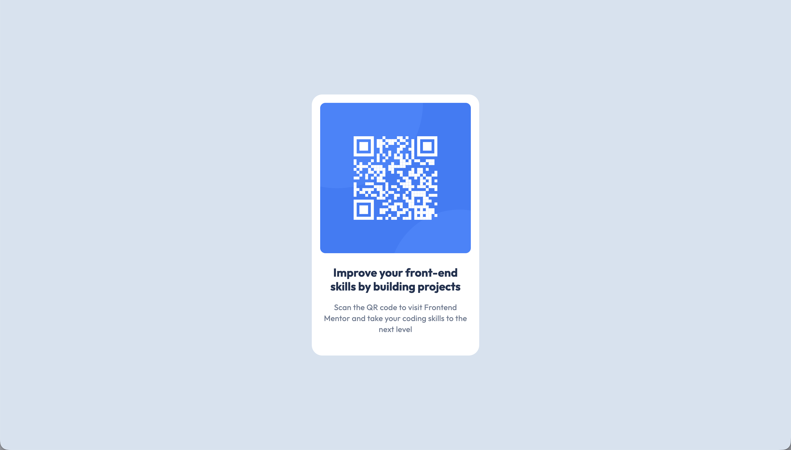

# QR Code Component

Frontend Mentor에서 제공하는 QR Code Component 디자인을 순수 HTML/CSS로 구현한 실습 프로젝트입니다.

## 프로젝트 정보

- **실습 출처:** [Frontend Mentor — QR Code Component](https://www.frontendmentor.io/challenges/qr-code-component-iux_sIO_H)
- **사용 기술:** HTML5, CSS3
- **개발 환경:** VS Code, Chrome DevTools, Live Server
- **디자인 도구:** Figma
## 구현 결과

### 완성 화면

### 배포 링크

[Live Demo](https://b-eunji.github.io/frontend-practice/html-css/01-qr-code/)

## Built with

- HTML5
- CSS3
- Flexbox
- Responsive Web Design

## Tools

- Figma
- Visual Studio Code
- Chrome DevTools

## 학습 목표

- 시맨틱 HTML을 활용한 구조 설계
- CSS Box Model과 Flexbox를 이용한 레이아웃 구현
- Figma 디자인 속성 분석 및 CSS 적용
- 반응형 웹페이지 구현
- Chrome DevTools를 활용한 스타일 검증

## 주요 구현 내용

- QR 이미지, 제목, 설명으로 구성된 카드 UI 구현
- Flexbox를 활용한 화면 중앙 정렬
- 중첩 Flexbox로 이미지와 텍스트 사이의 간격 관리
- Google Fonts의 Outfit 글꼴 적용
- `width`, `max-width`를 활용한 유동적인 카드 크기 설정
- CSS Reset으로 브라우저 기본 여백 초기화

## 학습 및 문제 해결

### 1. HTML 구조 설계

`main`, `div`, `h1`, `p` 등 HTML 요소의 의미와 역할을 구분하고, 불필요한 태그를 추가하지 않도록 구조를 설계했습니다.

### 2. Flexbox 간격 관리

처음에는 카드의 모든 요소에 동일한 `gap`이 적용되어 디자인과 간격이 달랐습니다.

제목과 설명을 별도의 그룹으로 묶고, 중첩 Flexbox를 활용해 이미지와 텍스트 그룹 사이의 24px, 제목과 설명 사이의 16px 간격을 구분했습니다.

### 3. 브라우저 기본 스타일 문제

제목과 문단에 기본적으로 적용되는 `margin`이 디자인과의 간격 차이를 발생시킬 수 있다는 점을 학습했습니다.

CSS Reset을 적용하고 Chrome DevTools에서 Box Model과 Flexbox 간격을 확인했습니다.

### 4. 반응형 카드 구현

초기에는 카드 너비를 320px로 고정했으나, 작은 화면에서도 카드 바깥 여백을 확보할 수 있도록 개선했습니다.

부모 요소의 `padding`과 카드의 `width: 100%`, `max-width: 320px`을 조합했습니다.

## 배운 점

- HTML 태그는 디자인보다 콘텐츠의 의미를 기준으로 선택해야 한다.
- Figma의 수치를 그대로 복사하는 것보다 레이아웃의 구조와 관계를 이해하는 것이 중요하다.
- `gap`과 `margin`은 서로 다른 방식으로 요소 간격에 영향을 준다.
- Flexbox의 정렬 속성은 부모 요소의 크기와 배치 방향에 따라 동작한다.
- DevTools를 통해 실제 적용된 CSS 속성과 레이아웃을 확인할 수 있다.

## 향후 보완할 점

- HTML/CSS 구조를 힌트 없이 독립적으로 설계하는 능력 강화
- Flexbox와 Box Model의 활용 숙련도 향상
- 다양한 화면 크기에서의 반응형 설계 경험 확대