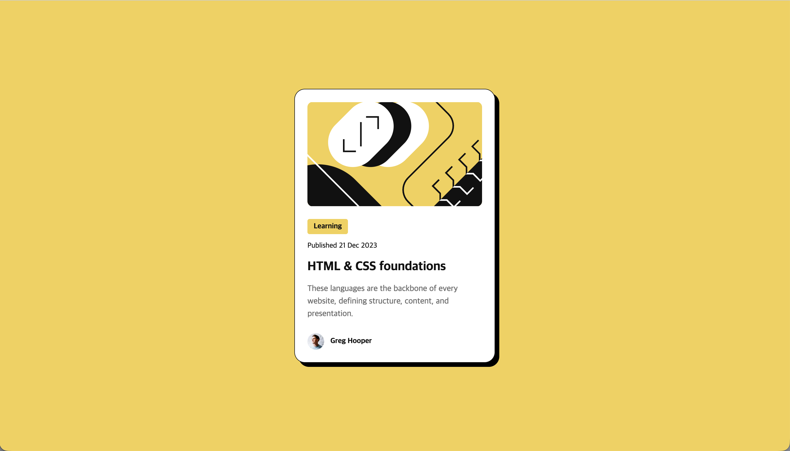

# Blog Preview Card

Frontend Mentor의 **Blog preview card** 챌린지를 HTML과 CSS로 구현한 프로젝트입니다.

Figma 디자인을 분석해 카드 레이아웃을 구현하고, 반응형 스타일과 키보드 접근성을 적용했습니다.

## 구현 결과

### 완성 화면

### 배포 링크

[Live Demo](https://b-eunji.github.io/frontend-practice/html-css/02-blog-preview-card/)

### 원본 챌린지

[Frontend Mentor - Blog Preview Card](https://www.frontendmentor.io/challenges/blog-preview-card-ckPaj01IcS)

## Built with

- HTML5
- CSS3
- Flexbox
- CSS Media Queries
- CSS Pseudo-classes (`:hover`, `:focus-visible`)

## Tools

- Figma
- Visual Studio Code
- Chrome DevTools
- Git / GitHub
- GitHub Pages

## 주요 구현 내용

### 1. 시맨틱 HTML 구조

- `main`, `article`로 주요 콘텐츠와 블로그 카드를 구분했습니다.
- `time`의 `datetime` 속성으로 게시 날짜를 표현했습니다.
- 제목을 링크로 구성하고, 장식용 이미지에 빈 `alt` 속성을 적용했습니다.

### 2. Figma 기반 레이아웃 구현

- Figma의 Auto Layout을 Flexbox로 구현했습니다.
- 카드, 텍스트 그룹, 작성자 프로필의 간격을 각각 분리했습니다.
- `width`와 `max-width`를 조합해 화면 너비에 따라 카드가 조절되도록 작성했습니다.

### 3. 반응형 스타일

- 모바일과 데스크톱 디자인의 글자 크기 차이를 미디어 쿼리로 반영했습니다.
- 화면 너비에 따라 카드와 텍스트가 자연스럽게 줄어들도록 구성했습니다.

### 4. 링크 상호작용

- `:hover`로 제목 링크에 마우스를 올렸을 때 색상이 변경되도록 구현했습니다.
- `:focus-visible`과 `outline`으로 키보드 포커스 위치를 표시했습니다.

## 학습 및 문제 해결

### Figma Auto Layout과 Flexbox의 차이

처음에는 Figma에서 Auto Layout이 적용된 모든 요소에 Flexbox가 필요하다고 생각했습니다.

Learning 배지처럼 내부 콘텐츠가 텍스트 하나인 경우에는 `inline-block`과 `padding`만으로도 디자인을 구현할 수 있다는 점을 배웠습니다.

### CSS 상속과 정렬 범위

부모 요소의 `align-items`가 자식 요소에도 상속되는지 확인했습니다.

`align-items`는 상속되지 않으며, 각 Flex 컨테이너의 직접적인 자식 요소에 적용된다는 점을 학습했습니다.

반면 `font-family`, `color` 등은 상속을 활용해 중복 선언을 줄였습니다.

### 반응형 기준점 결정

모바일과 데스크톱의 글자 크기 차이를 미디어 쿼리로 구현했습니다.

화면 너비를 조절하면서 자연스러운 줄바꿈과 레이아웃 오류를 구분하는 방법을 학습했습니다.

## 배운 점

- 시맨틱 HTML을 활용한 카드 구조 작성
- Figma 디자인 속성을 CSS로 변환하는 방법
- Flexbox의 중첩 구조와 정렬 범위
- CSS 상속과 선택자의 적용 범위
- 반응형 미디어 쿼리 작성
- Hover와 Focus 상태의 차이
- CSS 속성을 역할별로 구분해 작성하는 방법